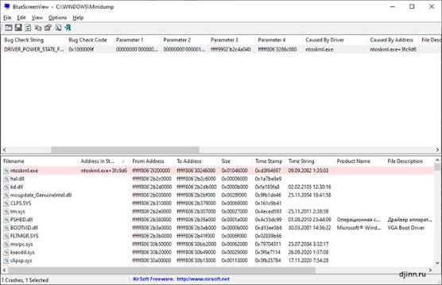
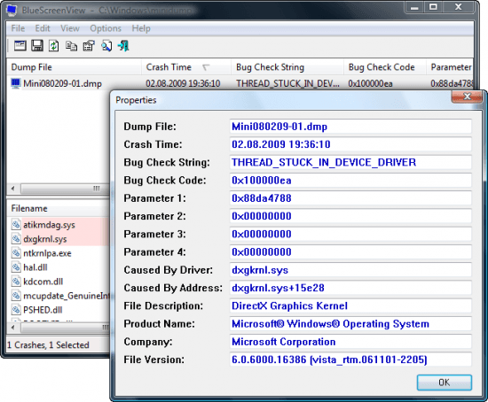

# BlueScreenView Windows Crash Dumps and Driver Reports

NirSoft BlueScreenView presents Windows minidumps in a compact crash overview.
Use it to compare failures, inspect driver clues, and prepare a diagnostic handoff.

[](https://github.com/antonioh7836/nirsoft-bluescreenview/releases/)

- Publisher: NirSoft, by Nir Sofer.
- Focus: Windows blue screen records and minidump inspection.

## Portable Crash Review

A BlueScreenView portable workflow keeps the viewer available alongside your diagnostic notes.
Start with a copy of the relevant dump and record which computer produced it.

For readers checking whether BlueScreenView is safe, verify the download source first.
Use the publisher's page and retain the original package information.
A familiar executable name alone does not establish provenance.

Keep a simple investigation record:

- Computer or case identifier.
- Windows version and architecture.
- Approximate time of the failure.
- Activity immediately before the crash.
- Recent driver, hardware, or firmware changes.

## Read the Crash Overview

The upper pane summarizes crashes; the lower pane provides details for the selected record.
Select a row before interpreting the driver information below it.

| Detail | Investigation use | Suggested note |
| --- | --- | --- |
| Dump filename | Associate the report with its input | Preserve the original name |
| Crash time | Match the failure to observed symptoms | Record the local time zone |
| Bug check code | Identify the stop condition | Keep its hexadecimal form |
| Bug check parameters | Preserve condition-specific context | Copy all available values |
| Driver or module | Identify a lead for investigation | Record its name and version |

The hexadecimal code belongs with its parameters and observed symptoms.
A code by itself rarely explains the complete sequence of events.



## Select the Dump Folder

The usual Windows small-dump location is `%SystemRoot%\Minidump`.
A configured location can differ, so confirm the source before comparing results.

The BlueScreenView minidump folder selection determines which records you review.
Keep dumps from different computers in separate case folders.

The following PowerShell example lists candidate files without opening them:

```powershell
$dumpFolder = Join-Path $env:SystemRoot 'Minidump'
Get-ChildItem -LiteralPath $dumpFolder -Filter '*.dmp' -File |
    Select-Object Name, Length, LastWriteTime
```

This is a PowerShell inventory command, separate from the viewer.
A filesystem modification time is not necessarily the recorded crash time.

## Open a Specific Source

From the directory containing the extracted executable, this PowerShell example selects a folder:

```powershell
# Select the standard Windows small-dump directory.
$dumpFolder = Join-Path $env:SystemRoot 'Minidump'
.\BlueScreenView.exe /LoadFrom 1 /MiniDumpFolder $dumpFolder
```

The documented source selector uses value `1` for a folder.
Choose the actual case folder when inspecting dumps collected elsewhere.

For a single-file review, Advanced Options provides a corresponding source choice.
Version v1.55 also accepts a single minidump dragged from Explorer.

## Interpret Driver Clues

A driver appearing in a crash record is a starting point for investigation.
Check whether the same lead recurs across several independent failures.

Separate these observations in your notes:

- The module was present.
- The module appeared in the selected crash context.
- Additional evidence connects the module to the failure.

Small dumps contain limited information about the failing system.
Failures originating outside the captured thread can require more evidence.

Avoid treating a highlighted kernel component as sufficient reason to replace a system file.
Compare the failure pattern with recent changes and the machine's symptoms.

## Compare Repeated Failures

Review several crashes before making a change.
Look for stable patterns across time, workloads, and driver versions.

| Pattern | Useful next observation |
| --- | --- |
| Same code and module recur | Check the module's version and change history |
| Different codes follow one change | Record the exact timing of that change |
| Failures happen during one workload | Describe the workload and connected devices |
| A new dump follows a repair attempt | Compare it with the earlier baseline |

Change one relevant variable at a time where practical.
Keep the earlier evidence so that later comparisons remain meaningful.



## Export a Reviewable Summary

The following PowerShell example writes a CSV report in the current directory.
Use a fresh report name if an earlier export must be preserved.

```powershell
$dumpFolder = Join-Path $env:SystemRoot 'Minidump'
$report = Join-Path (Get-Location).Path 'crash-summary.csv'
.\BlueScreenView.exe /LoadFrom 1 /MiniDumpFolder $dumpFolder /scomma $report /sort "~Crash Time"
```

The documented `/scomma` option exports the crash list.
The sort expression requests descending crash time.

A report is a summary of observations.
Retain the corresponding dump for anyone performing deeper analysis.

## When No Dumps Are Displayed

Check the input before drawing conclusions about system stability.

1. Confirm that the selected folder belongs to the affected Windows installation.
2. Check whether it contains readable, nonempty dump files.
3. Confirm that Windows is configured to create small memory dumps.
4. Check whether cleanup or retention rules removed older evidence.
5. Record any access error or unsupported-file symptom.

Changing dump settings cannot recreate a file from an earlier crash.

A blank list alone does not establish that the computer never crashed.

## Validate or Escalate the Evidence

If a file appears damaged, Microsoft's DumpChk can check its readability.
It is supplied with Debugging Tools for Windows.

For detailed kernel analysis, continue with WinDbg and appropriate symbols.
Preserve the original dump and document the analysis environment.

A useful handoff includes:

- The dump filename and computer identifier.
- The observed symptom and approximate crash time.
- The bug check code and parameters.
- Relevant driver versions and recent changes.
- The exported summary and actions already attempted.

## Version and Publisher Reference

The publisher currently lists BlueScreenView v1.55.
Its published Windows compatibility list stops at Windows 10.
Check actual dump readability before relying on a newer Windows workflow.

Nir Sofer identifies NirSoft as a personal project.

## Related Search Terms

nirsoft bluescreenview, bluescreenview portable, bluescreenview safe, bluescreenview minidump folder, bluescreenview bug check code, windows, bsod, minidump, crash-dump, kernel-dump, dmp, dumps, debugging, windbg, troubleshooting
